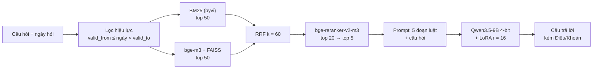

# DAT301m — Hỏi đáp luật giao thông Việt Nam theo phiên bản hiệu lực

Hệ thống hỏi đáp luật giao thông đường bộ Việt Nam **biết phiên bản**: với mỗi câu hỏi và **ngày hỏi**, hệ thống chỉ dùng
các quy định **đang có hiệu lực tại ngày đó**, tìm căn cứ bằng RAG rồi để mô hình **Qwen3.5-9B** (fine-tune QLoRA) trả
lời kèm trích dẫn Điều/Khoản.

Luật giao thông thay đổi nhanh (Luật Trật tự, an toàn giao thông đường bộ 2024, NĐ 168/2024 thay NĐ 100/2019, cấp huyện bị
bỏ từ 01/7/2025…), nên mô hình chỉ dựa vào kiến thức lúc train rất dễ trả lời theo luật cũ. Dự án đo xem RAG, fine-tune và
bộ lọc hiệu lực mỗi thứ đóng góp bao nhiêu.

## Câu hỏi nghiên cứu

| | Câu hỏi | Thực nghiệm |
|---|---|---|
| **RQ1** | RAG và fine-tune đóng góp bao nhiêu? | 4 cấu hình: A (gốc), B (gốc + RAG), C (LoRA), D (LoRA + RAG) |
| **RQ2** | Cách cắt đoạn và tìm kiếm nào tốt nhất? | BM25 / vector / hybrid / + reranker; cắt theo Khoản hay theo Điều |
| **RQ3** | Lọc theo hiệu lực có giúp trả lời theo luật mới không? | 40 câu về quy định đã sửa, có và không lọc, ở cả tìm kiếm và câu trả lời |

## Kết quả chính

Tất cả số liệu tính trên **tập test 240 câu**, khoảng tin cậy 95% bằng bootstrap theo họ sự kiện.

**RQ1 — RAG quyết định độ đúng, LoRA quyết định cách trả lời** ([reports/g7](reports/g7/README.md),
[reports/g8](reports/g8/README.md)):

| Chỉ số | A: gốc | B: gốc + RAG | C: LoRA | D: LoRA + RAG |
|---|---:|---:|---:|---:|
| Nêu đúng mọi số liệu (n = 95) | 4,2 | **61,1** | 11,6 | **60,0** |
| Trích đúng Khoản (n = 164) | 0,0 | **86,0** | 1,2 | 82,3 |
| Trích văn bản ngoài kho ↓ | 94,4 | 4,7 | 21,0 | **0,5** |
| Lặp vòng ↓ | 11,7 | 10,0 | 8,8 | **0,0** |
| Token trả lời / giây mỗi câu | 380 / 31,9 | 312 / 28,5 | 106 / 11,9 | **88 / 12,3** |
| Đạt nội dung, trong phạm vi (LLM-judge, n = 170) | | 82,4 | | **85,9** |
| Nêu sai chế tài ↓ (LLM-judge) | | 10,0 | | **1,2** |

- Không có RAG, mô hình gốc trích **văn bản đã hết hiệu lực ở 94% câu** (NĐ 100/2019, Luật GTĐB 2008…).
- Có RAG rồi thì LoRA không làm số liệu đúng hơn một cách có ý nghĩa, nhưng câu trả lời **ngắn hơn 3,5 lần, nhanh hơn
  2,3 lần, hết lặp vòng** và bịa chế tài ít hơn hẳn.
- LoRA mà không có RAG là cấu hình tệ nhất: sai và bịa số hiệu văn bản.

**RQ2 — tìm kiếm** ([reports/retrieval](reports/retrieval/summary.md)), câu thường, top 5:

| Cấu hình (cắt theo Khoản) | any | all | MRR |
|---|---:|---:|---:|
| Chỉ BM25 | 0,72 | 0,48 | 0,48 |
| Chỉ vector (bge-m3) | 0,87 | 0,63 | 0,73 |
| Hybrid (RRF) | 0,87 | 0,60 | 0,71 |
| **Hybrid + reranker** | **0,93** | **0,66** | **0,80** |

Cắt theo Điều tìm đủ căn cứ tốt hơn (all 0,87). Cải tiến G8 "tìm theo Khoản rồi mở rộng lên Điều cha" (ngân sách 2.500
token) nâng all từ 0,66 lên 0,83, nhưng câu trả lời chỉ đúng hơn khoảng 1–3 điểm và trích dẫn Khoản kém cụ thể hơn.

**RQ3 — lọc hiệu lực:**
- Ở tìm kiếm: có lọc, 0/36 câu sửa đổi lấy nhầm bản cũ; bỏ lọc, 32/36 câu có bản cũ trong top 5.
- Ở câu trả lời: bỏ lọc thì B nêu số liệu bản cũ ở **61,9%** câu, D ở **33,3%**; có lọc, B 4,8%, D **0%**.

**Điểm yếu còn lại:** câu hỏi kiểu đời thường, viết tắt, không dấu (nhóm biến thể) chỉ đạt khoảng 37–41%, chủ yếu vì
tìm kiếm lấy nhầm Điều. Ví dụ "nón bảo hiểm" không xuất hiện trong luật (luật viết "mũ bảo hiểm").

## Kiến trúc



## Dữ liệu

| Thành phần | Quy mô | Ở đâu |
|---|---|---|
| Văn bản luật gốc | 40 văn bản (Luật, Nghị định, Thông tư, QCVN 41, văn bản hợp nhất BLHS / Luật XLVPHC, BLDS) + bộ 600 câu sát hạch GPLX | tải bằng `scripts/download_raw.py`, danh sách và sha256 ở [data/manifest.csv](data/manifest.csv) (thư mục `data/raw/` không đưa lên git) |
| Kho luật có cấu trúc | 19.451 đơn vị (Điều / Khoản / Điểm / Phụ lục) | [data/processed/legal_units.jsonl](data/processed/legal_units.jsonl) |
| Kho luật theo phiên bản | 20.500 phiên bản, mỗi bản có `valid_from` / `valid_to`; 568 lệnh sửa đổi đã rà | [data/processed/legal_units_versioned.jsonl](data/processed/legal_units_versioned.jsonl) |
| Đoạn cho RAG | 6.221 đoạn theo Khoản, 2.149 đoạn theo Điều | [data/rag/](data/rag/) |
| Bộ đánh giá `eval_v1` | 270 câu (dev 30, test 240): thường 150, biến thể 50, sửa đổi 40, ngoài phạm vi 30 | [data/eval/](data/eval/README.md) |
| Dữ liệu fine-tune `train-v1` | 1.375 câu train + 192 câu dev (chia theo Điều); thành 1.662 hội thoại train sau khi nhân đôi nhóm thiếu | [data/train/](data/train/README.md) |

Mốc thời gian của kho là **01/10/2026**. Phân tích dữ liệu (EDA) ở [reports/eda](reports/eda/) và notebook
[01_eda_kho_luat](notebooks/01_eda_kho_luat.ipynb).

## Fine-tune

- QLoRA trên `Qwen/Qwen3.5-9B` (4-bit) bằng Unsloth, LoRA r = 16, alpha = 16, gắn vào `q/k/v/o_proj` và `gate/up/down_proj`.
- 29.097.984 tham số được train, khoảng 0,32% mô hình. Adapter nặng 116 MB.
- Siêu tham số: lr 2e-4 cosine, warmup 5%, batch hiệu dụng 8, tối đa 4.096 token, 2 vòng (416 bước).
- Train mất 2,37 giờ trên RTX 5060 Ti 16 GB, VRAM đỉnh 9,17 GB.
- Giữ checkpoint **bước 208**, có dev loss thấp nhất (0,313); dev loss của mô hình gốc là 0,804.
- Script [scripts/g6_train.py](scripts/g6_train.py), kết quả [reports/g6](reports/g6/README.md).

## Cấu trúc thư mục

```
src/lawproc/     Xử lý văn bản luật: chuyển đổi, tách cấu trúc, ngày hiệu lực, áp dụng sửa đổi, bộ eval
src/rag/         RAG: chunking, BM25, dense (bge-m3), retrieve (RRF + reranker), expand (G8), chấm điểm
scripts/         Các bước chạy của pipeline (xem bảng dưới)
notebooks/       EDA và notebook chạy trên GPU (Kaggle / máy thuê)
kaggle/, remote/ Gói và hướng dẫn chạy trên Kaggle (G4, G5, G7, G8, G9) và máy thuê (G6)
data/            Dữ liệu đã xử lý, đoạn RAG, bộ eval, dữ liệu train
reports/         Kết quả từng giai đoạn và Report 3
docs/            Kế hoạch, thiết kế và các lượt review
tests/           Kiểm thử pytest
```

## Các giai đoạn

| Giai đoạn | Nội dung | Script / notebook chính | Kết quả |
|---|---|---|---|
| G0 | Thu thập, xử lý kho luật, EDA | `download_raw.py`, `process_legal.py all`, `process_gplx.py` | `data/processed/`, `reports/eda/` |
| G2 | Bộ đánh giá `eval_v1` | `build_eval.py` | `data/eval/` |
| G3 | Chunking, chỉ mục, tìm kiếm (RQ2, RQ3) | `build_chunks.py`, `build_index.py`, `run_retrieval.py` | `data/rag/`, `reports/retrieval/` |
| G4 | Thử mô hình trên Kaggle | `notebooks/02_g4_kaggle`, `03_g4_kaggle_v2` | `reports/g4/` |
| G5 | Dữ liệu fine-tune | `g5_drafts/`, `build_trainset.py`, `notebooks/04_g5_context`, `finalize_g5ctx.py` | `data/train/` |
| G6 | Fine-tune QLoRA | `g6_train.py` (máy thuê, `remote/g6/`) | `reports/g6/` |
| G7 | Thực nghiệm A/B/C/D (RQ1, RQ3) | `g7_generate.py` (Kaggle), `score_g7.py` | `reports/g7/` |
| G8 | Phân tích lỗi, LLM-judge, mở rộng Khoản lên Điều | `g8_errors.py`, `g8_context.py`, `score_g8.py`, `g8_judge_summary.py` | `reports/g8/` |
| G9 | Demo Gradio trên Kaggle | `g9_demo.py`, `build_g9_bundle.py` | `kaggle/g9/` |

Kế hoạch tổng thể: [docs/superpowers/plans/2026-10-16-ke-hoach-tong-the.md](docs/superpowers/plans/2026-10-16-ke-hoach-tong-the.md).
Báo cáo 3 (mô hình và kết quả): [reports/report3](reports/report3/report_3_mo_hinh_ket_qua.md).

## Chạy lại

Phần xử lý dữ liệu và tìm kiếm chạy được trên laptop (CPU). Môi trường: Python 3.13 trên Windows, Tesseract 5.4 cài
riêng cho OCR (xem [data/COLLECTION_LOG.md](data/COLLECTION_LOG.md)).

```bash
py -3.13 -m pip install torch==2.14.1 --index-url https://download.pytorch.org/whl/cpu
py -3.13 -m pip install -r requirements.txt

py -3.13 scripts/download_raw.py            # tải văn bản gốc vào data/raw/
py -3.13 scripts/process_legal.py all       # dựng kho luật theo phiên bản
py -3.13 scripts/build_chunks.py            # cắt đoạn cho RAG
py -3.13 scripts/build_index.py             # chỉ mục BM25 + bge-m3/FAISS
py -3.13 scripts/run_retrieval.py --tap dev # chọn tham số trên dev
py -3.13 -m pytest                          # chạy kiểm thử
```

Phần cần GPU (G5 gắn ngữ cảnh, G6 train, G7/G8 sinh câu trả lời, G9 demo) có gói và hướng dẫn riêng trong `HUONG_DAN.md`
của từng thư mục [kaggle/](kaggle/) và [remote/](remote/). Các gói `.zip` lớn được tạo lại bằng `scripts/build_*_bundle.py`.

Tập test chỉ chạy **một lần**. `run_retrieval.py --tap test` và `g8_context.py` từ chối chạy lại nếu không có `--force`.

## Hạn chế

- Kho luật dừng ở 01/10/2026 và chưa có một số văn bản (ví dụ NĐ 189/2025 về thẩm quyền xử phạt, TT 47/2024 về xe cải tạo).
- LLM-judge chỉ có một giám khảo (Claude), không mù lượt; phiếu chấm tay 50 câu để kiểm giám khảo chưa điền xong.
- Câu hỏi đời thường vẫn yếu; hướng tiếp theo là viết lại câu hỏi sang thuật ngữ luật, và kéo kèm Khoản trừ điểm khi lấy
  Khoản mức phạt của NĐ 168.
- Hệ thống phục vụ học tập và nghiên cứu, **không thay thế tư vấn pháp lý**.
