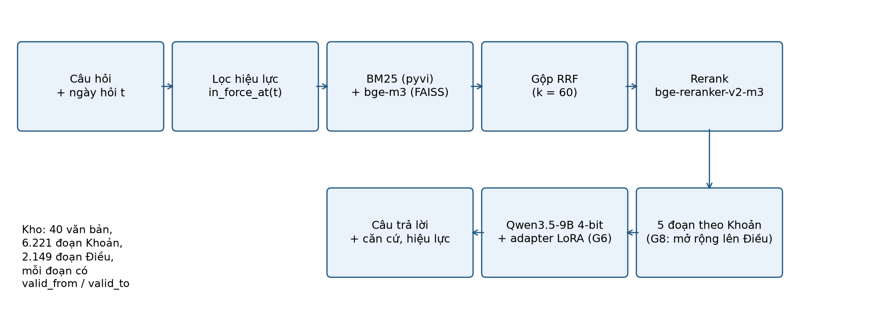
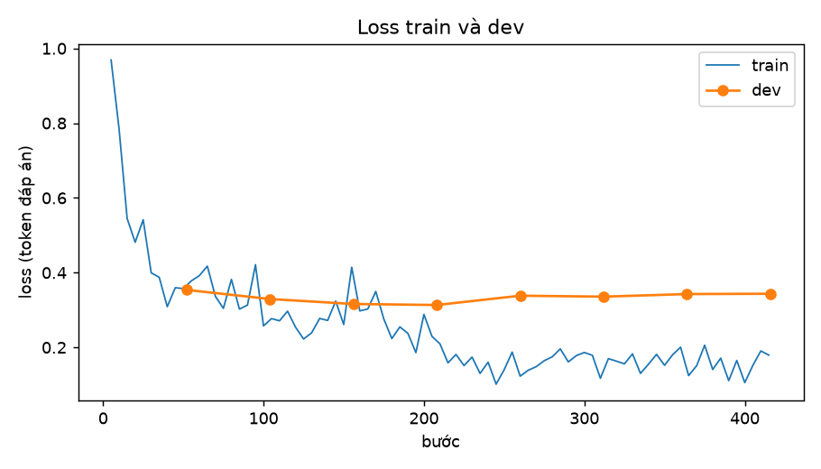
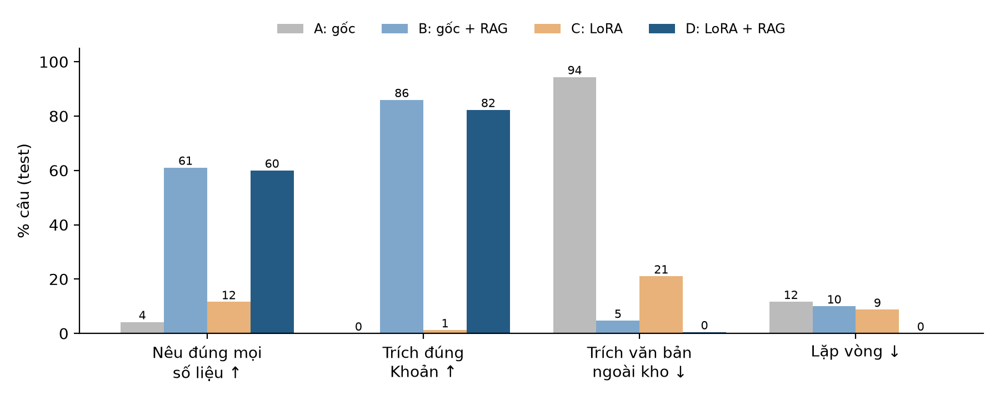
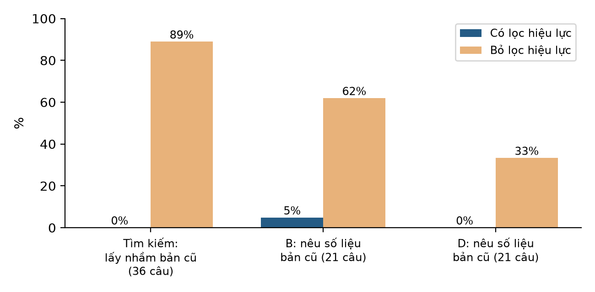
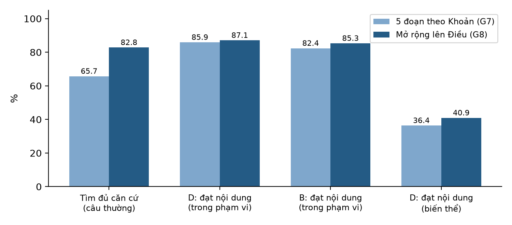

# Report 3 — Mô hình và kết quả

**Môn:** DAT301m — Dự án AI end-to-end
**Đề tài:** Xây dựng hệ thống hỏi đáp pháp luật cho người tham gia giao thông đường bộ Việt Nam theo hiệu lực văn bản, kết hợp RAG và fine-tune LoRA
**Tên tiếng Anh:** Vietnamese Road-User Law Question Answering with Version-Aware RAG and LoRA Fine-Tuning
**Nhóm:** (điền tên thành viên)
**Ngày chốt dữ liệu / ngày hỏi mặc định:** 01/10/2026
**Ngày báo cáo:** 20/10/2026

---

## Tóm tắt

Báo cáo này trình bày phần mô hình và kết quả của hệ thống hỏi đáp pháp luật giao thông đường bộ có nhận biết hiệu lực
văn bản. Hệ thống gồm hai thành phần:

- **Tìm kiếm (RAG):** **lọc đoạn luật theo hiệu lực tại ngày hỏi**, rồi BM25 kết hợp vector bge-m3 bằng RRF và xếp hạng
  lại bằng bge-reranker-v2-m3.
- **Sinh câu trả lời:** Qwen3.5-9B nạp 4-bit, fine-tune QLoRA trên 1.662 hội thoại có gắn ngữ cảnh.

Đánh giá trên 240 câu test của bộ eval tự xây (`eval_v1`) cho ba kết luận chính:

1. **RQ1, RAG quyết định độ đúng.** Tỷ lệ nêu đúng mọi số liệu tăng từ 4% (mô hình gốc) lên 61% khi có RAG. Fine-tune
   LoRA không làm câu trả lời đúng hơn, nhưng giúp trả lời gọn hơn 3,5 lần, sinh nhanh hơn 2,3 lần, hết lặp vòng và giảm
   bịa chế tài: theo chấm nội dung, B sai chế tài ở 10,0% câu, D chỉ 1,2%.
2. **RQ2, hybrid + reranker tốt nhất.** Ở câu thường, cấu hình này tìm được ít nhất một căn cứ ở 93% câu, MRR 0,80. Cắt
   theo Điều tìm đủ căn cứ nhiều hơn cắt theo Khoản (87% so với 66%), nhưng prompt quá dài cho GPU T4.
3. **RQ3, lọc hiệu lực là bắt buộc.** Bỏ lọc thì 32/36 câu sửa đổi lấy nhầm bản cũ khi tìm kiếm, và tỷ lệ câu trả lời nêu
   số liệu bản cũ tăng từ 0–5% lên 33–62%.

Chấm nội dung 960 câu trả lời cho thấy cấu hình LoRA + RAG đạt 85,9% câu trong phạm vi. Phân tích lỗi cho thấy phần lớn
câu sai bắt nguồn từ bước tìm kiếm. Cải tiến G8 (mở rộng đoạn Khoản lên cả Điều) tăng tỷ lệ tìm đủ căn cứ từ 65,7% lên
82,8%, nhưng độ đúng câu trả lời chỉ tăng 1,2 điểm, chưa có ý nghĩa thống kê.

## 1. Bài toán và câu hỏi nghiên cứu

Người dùng hỏi bằng tiếng Việt kèm ngày hỏi t (mặc định 01/10/2026). Hệ thống phải trả lời **theo quy định có hiệu lực
tại t**, nêu căn cứ (văn bản, Điều, Khoản) và từ chối khi câu hỏi nằm ngoài phạm vi. Giai đoạn 2024–2026, luật giao thông
thay đổi rất dày (Luật 35, 36/2024; NĐ 168/2024 rồi NĐ 238/2026 sửa NĐ 168; TT 108/2026 thay TT 12/2025...). Vì vậy câu
hỏi đúng nhưng trả lời theo bản cũ vẫn là sai.

| Mã | Câu hỏi | Thực nghiệm |
|---|---|---|
| RQ1 | RAG và fine-tune đóng góp bao nhiêu vào độ đúng? | 4 cấu hình A (gốc), B (gốc + RAG), C (LoRA), D (LoRA + RAG) |
| RQ2 | Cách cắt đoạn và tìm kiếm nào tốt nhất? | BM25 / vector / hybrid / + reranker; cắt theo Khoản và theo Điều |
| RQ3 | Lọc theo hiệu lực có giúp trả lời theo luật mới không? | Bật và tắt lọc `in_force_at` trên 36 câu sửa đổi (test), ở cả tìm kiếm và câu trả lời |

## 2. Dữ liệu dùng cho mô hình (tóm tắt từ Report 2)

| Dữ liệu | Quy mô | Ghi chú |
|---|---|---|
| Kho văn bản (`data-v1`) | 40 văn bản, 20.500 phiên bản đơn vị (Điều, Khoản, Điểm, phụ lục) | Mỗi phiên bản có `valid_from`, `valid_to`, ngoại lệ hiệu lực; BLDS, BLHS chỉ giữ 213 đơn vị liên quan |
| Kho tra cứu | 6.221 đoạn theo Khoản (4.665 có hiệu lực tại t); 2.149 đoạn theo Điều | Đoạn = một Khoản kèm các Điểm, có tiêu đề Điều và tên văn bản; dài quá 512 token thì tách theo Điểm |
| Bộ eval `eval_v1` | 270 câu: 150 thường, 40 sửa đổi, 30 ngoài phạm vi, 50 biến thể đời thường | Chia 30 dev, 240 test; đóng băng ngày 17/10/2026, ghi mã băm |
| Dữ liệu train `train-v1` | 1.375 cặp hỏi đáp train, 192 dev (chia theo Điều) → 1.662 hội thoại train | Có ngữ cảnh 5 đoạn (khoảng 90%), không ngữ cảnh (khoảng 10%), mẫu từ chối |

Câu sửa đổi là câu mà cùng một câu hỏi có hai đáp án khác nhau ở hai ngày (ví dụ thời hạn 07 thành 05 ngày làm việc).
Câu biến thể viết lại câu thường theo kiểu đời thường, viết tắt, không dấu ("bằng lái", "nón bảo hiểm", "phạt bn").

## 3. Phương pháp

### 3.1 Kho tra cứu và tìm kiếm (G3)

- **Chỉ mục:** BM25 với tách từ pyvi; vector bge-m3 (FAISS, chạy CPU).
- **Tìm kiếm:** lọc hiệu lực tại ngày hỏi ngay trong BM25 và vector (đoạn hết hiệu lực bị loại trước khi xếp hạng); lấy
  50 kết quả BM25 và 50 kết quả vector, gộp bằng Reciprocal Rank Fusion (k = 60), xếp hạng lại 20 đoạn đầu bằng
  bge-reranker-v2-m3, giữ 5 đoạn.
- **Lọc hiệu lực:** hàm `in_force_at(đoạn, t)` giữ đoạn có `valid_from ≤ t` và chưa hết hiệu lực, có xét ngoại lệ (ví dụ
  TT 12/2025 còn áp dụng đến hết 28/02/2027 cho một số trường hợp). Mỗi đoạn trong prompt ghi "hiệu lực từ … đến …".
- **Tham số** chốt trên 30 câu dev, không dùng test (`reports/retrieval/params.json`).

### 3.2 Chọn mô hình (G4)

Chạy thử trên Kaggle T4 (16 GB) với Qwen3.5-9B và Qwen3.5-4B, nạp 4-bit bằng Unsloth:

- 9B dùng 8,0 GB VRAM, sinh 26 giây/câu với ngữ cảnh theo Khoản.
- 4B không nhanh hơn rõ (22,5 giây/câu) và bịa số tiền ở câu lệ phí.
- Ngữ cảnh theo Điều (đến 20.000 token) làm T4 hết bộ nhớ; chỉ chạy được khi giới hạn khoảng 4.000 token.

**Chọn Qwen3.5-9B**, ngữ cảnh 5 đoạn theo Khoản làm cấu hình chính.

### 3.3 Dữ liệu train và fine-tune QLoRA (G5, G6)

- **Dữ liệu train:** cặp hỏi đáp soạn từ các đơn vị luật đang có hiệu lực. Mỗi mẫu được gắn 5 đoạn do chính retriever G3
  tìm. Nếu retriever bỏ sót căn cứ thì chèn đoạn đúng vào, để mô hình học cách đọc ngữ cảnh. Mẫu từ chối dạy mô hình nói
  "không có căn cứ" thay vì bịa.
- **Cấu hình:** LoRA r = 16, alpha = 16, các lớp `q, k, v, o, gate, up, down_proj`; adamw_8bit, lr 2e-4, cosine, warmup 5%;
  lô hiệu dụng 8; 2 vòng (416 bước); độ dài tối đa 4.096 token; seed 42. Chỉ tính loss trên phần câu trả lời. Prompt
  dùng khuôn chat Qwen, giống hệt lúc sinh.
- **Máy:** RTX 5060 Ti 16 GB (thuê), bf16, 2,37 giờ, VRAM đỉnh 9,17 GB.
- **Chọn checkpoint:** bước 208 (hết vòng 1), có loss dev thấp nhất (0,313). Vòng 2 quá khớp nhẹ: loss train còn khoảng
  0,15 trong khi loss dev tăng lại 0,34.

| Loại câu (dev) | Loss mô hình gốc | Loss sau train |
|---|---|---|
| Tất cả | 0,804 | 0,316 |
| Mức phạt | 0,567 | 0,245 |
| Thủ tục | 0,905 | 0,453 |
| Từ chối | 2,117 | 0,244 |
| Có ngữ cảnh / không ngữ cảnh | 0,656 / 1,594 | 0,267 / 0,947 |

Loss giảm mạnh nhất ở mẫu từ chối và mẫu có ngữ cảnh. Mẫu không ngữ cảnh vẫn có loss cao (0,947): mô hình không học
thuộc được nội dung luật, đúng như kỳ vọng.

### 3.4 Sinh câu trả lời và các cấu hình (G7)

| Cấu hình | Mô hình | Ngữ cảnh |
|---|---|---|
| A | Qwen3.5-9B gốc | Không |
| B | Qwen3.5-9B gốc | 5 đoạn theo Khoản, có lọc hiệu lực |
| C | Qwen3.5-9B + LoRA | Không |
| D | Qwen3.5-9B + LoRA | 5 đoạn theo Khoản, có lọc hiệu lực |
| B, D bỏ lọc | như B, D | 5 đoạn khi tắt lọc hiệu lực (chỉ 40 câu sửa đổi) |

Sinh greedy, tối đa 512 token, trên Kaggle T4 x2 (fp16). A, B tắt adapter trên cùng mô hình đã nạp, nên bốn cấu hình dùng
chung một bản mô hình gốc. Tổng 1.160 câu trả lời trong khoảng 3,5 giờ.

### 3.5 Cách chấm

- **Chấm tự động** theo rubric của bộ eval (`src/rag/answer_score.py`, có test): nêu đúng mọi số liệu, khung phạt tiền,
  điểm trừ, tước GPLX, trích đúng văn bản/Điều/Khoản, trích văn bản ngoài kho (cũ hoặc bịa), từ chối đúng/sai, nêu số liệu
  bản cũ (RQ3), ROUGE-L, lặp vòng.
- **Chấm nội dung (LLM-Judge):** với 4 lượt B, D, B_g8, D_g8 × 240 câu (960 nhãn), giám khảo đọc câu hỏi, đáp án chuẩn
  và câu trả lời, rồi gắn nhãn **đạt** (đủ ý chính, kết luận đúng), **sai chế tài** và **theo luật cũ**. Giám khảo là
  Claude (claude-opus-5-5), khác họ với mô hình được chấm. Mức phạt nào không có trong đáp án thì được tra lại trong kho
  trước khi tính là bịa.
- **Thống kê:** khoảng tin cậy 95% bằng bootstrap theo cụm (họ sự kiện hoặc họ câu, để các câu gần giống nhau không bị
  tính như độc lập). So sánh hai cấu hình là **bootstrap ghép cặp** trên cùng câu. Hiệu số được coi là có ý nghĩa khi
  CI95 không chứa 0.

## 4. Kết quả

### 4.1 RQ2: tìm kiếm

Bảng dưới là kết quả trên câu thường của tập test (n = 134), top 5. "any" là tìm được ít nhất một nhóm căn cứ, "all" là
tìm đủ mọi nhóm, MRR là nghịch đảo hạng của đoạn đúng đầu tiên.

| Cấu hình | Cắt | any | all | MRR |
|---|---|---|---|---|
| Chỉ BM25 | Khoản | 0,72 | 0,48 | 0,48 |
| Chỉ vector | Khoản | 0,87 | 0,63 | 0,73 |
| Hybrid (RRF) | Khoản | 0,87 | 0,60 | 0,71 |
| **Hybrid + reranker** | **Khoản** | **0,93** | 0,66 | **0,80** |
| Hybrid + reranker, bỏ lọc hiệu lực | Khoản | 0,90 | 0,61 | 0,73 |
| Hybrid + reranker | Điều | 0,92 | **0,87** | 0,78 |

- Reranker là bước có lợi nhất: any tăng 6 điểm, MRR tăng 0,09 so với hybrid.
- Cắt theo Điều tìm đủ căn cứ nhiều hơn hẳn (0,87 so với 0,66), vì câu trả lời thường cần nhiều Khoản của cùng một
  Điều. Nhưng prompt theo Điều có thể dài gần 20.000 token, vượt sức T4. Phát hiện này dẫn tới cải tiến G8 (mục 6).
- **Câu biến thể** tụt mạnh: any chỉ 0,52 so với 0,86 ở câu gốc tương ứng. Đây là điểm yếu lớn nhất của bước tìm kiếm.

### 4.2 RQ1: đóng góp của RAG và fine-tune

| Chỉ số (test) | n | A: gốc | B: gốc + RAG | C: LoRA | D: LoRA + RAG |
|---|---|---|---|---|---|
| Nêu đúng mọi số liệu ↑ | 95 | 4,2 | **61,1** | 11,6 | **60,0** |
| Đúng khung phạt tiền ↑ | 17 | 5,9 | **88,2** | 17,6 | **88,2** |
| Trích đúng Khoản ↑ | 164 | 0,0 | **86,0** | 1,2 | 82,3 |
| Trích văn bản ngoài kho (cũ, bịa) ↓ | 214 | 94,4 | 4,7 | 21,0 | **0,5** |
| Từ chối đúng câu ngoài phạm vi ↑ | 26 | 34,6 | **100,0** | 61,5 | 92,3 |
| ROUGE-L F1 ↑ | 214 | 0,157 | 0,326 | 0,286 | **0,581** |
| Lặp vòng ↓ | 240 | 11,7 | 10,0 | 8,8 | **0,0** |
| Token trả lời trung bình / giây mỗi câu | 270 | 380 / 31,9 | 312 / 28,5 | 106 / 11,9 | **88 / 12,3** |

Các hiệu số ghép cặp chính (điểm %, CI95):

| So sánh | Nêu đúng mọi số liệu | Trích văn bản ngoài kho | ROUGE-L |
|---|---|---|---|
| B − A (thêm RAG vào mô hình gốc) | **+56,8** [+46,2; +67,0] | **−89,7** [−93,9; −85,1] | +0,169 * |
| C − A (chỉ fine-tune) | +7,4 [+2,1; +13,7] | −73,4 * | +0,129 * |
| D − B (thêm LoRA khi đã có RAG) | −1,1 [−10,0; +7,6] | **−4,2** [−6,9; −1,8] | **+0,255** [+0,228; +0,283] |

Ví dụ cùng một câu hỏi `thuong/xp03`: "Lái ô tô không chấp hành hiệu lệnh của đèn tín hiệu giao thông bị xử phạt như thế
nào?" Đáp án đúng là phạt 18–20 triệu đồng và trừ 04 điểm (NĐ 168/2024).

| Cấu hình | Câu trả lời (rút gọn) | Nhận xét |
|---|---|---|
| A: gốc | "Theo NĐ 100/2019 ... phạt 800.000 đến 1.000.000 đồng, tước GPLX 01–02 tháng" | Trả lời theo văn bản đã hết hiệu lực |
| C: LoRA | "phạt 1.000.000 đến 2.000.000 đồng (điểm a khoản 10 Điều 6 NĐ 168/2024) ... trừ 02 điểm" | Đúng văn bản nhưng bịa số liệu |
| B: gốc + RAG | "18.000.000 đến 20.000.000 đồng ... trừ 9 điểm" | Đúng tiền, sai điểm trừ |
| D: LoRA + RAG | "18.000.000 đến 20.000.000 đồng (điểm b khoản 9 Điều 6 NĐ 168/2024) ... trừ 04 điểm" | Đúng |

**Kết luận RQ1.**

- Không có RAG, mô hình 9B gần như luôn trả lời theo luật cũ (94% câu trích văn bản ngoài kho như NĐ 100/2019, Luật Giao
  thông đường bộ 2008).
- Fine-tune một mình không sửa được điều này. Mô hình C còn bịa số hiệu văn bản không tồn tại.
- Khi đã có RAG, LoRA không làm số liệu đúng hơn (D − B không có ý nghĩa). Nhưng LoRA đổi **cách trả lời**: gọn, đúng
  định dạng, không lặp, nhanh gấp đôi, gần như không trích văn bản lạ.
- Mô hình không học thuộc luật: ở D, Khoản đã gặp khi train và Khoản chưa gặp không tạo lợi thế (51,7% so với 75,8%
  nêu đúng số liệu).

### 4.3 RQ3: lọc hiệu lực

| Chỉ số (câu sửa đổi, test) | B | B bỏ lọc | D | D bỏ lọc |
|---|---|---|---|---|
| Tìm kiếm: lấy nhầm đoạn bản cũ | 0/36 | 32/36 | 0/36 | 32/36 |
| Nêu số liệu của bản cũ ↓ (n = 21) | 4,8 | **61,9** | **0,0** | 33,3 |
| Trả lời theo bản mới ↑ (n = 21) | 85,7 | 81,0 | **90,5** | 71,4 |

- Bỏ lọc làm tỷ lệ trả lời theo bản cũ tăng có ý nghĩa: B +57,1 điểm [+33,3; +76,2], D +33,3 điểm [+14,3; +52,4].
- Chỉ ghi chú "hiệu lực từ … đến …" trong ngữ cảnh là **không đủ** để mô hình tự loại bản cũ. Lọc ở bước tìm kiếm là
  thành phần bắt buộc.
- D chống chịu tốt hơn B khi ngữ cảnh lẫn bản cũ (33% so với 62%), có thể nhờ được train trên ngữ cảnh có ghi hiệu lực;
  n = 21 nên chỉ là dấu hiệu.

### 4.4 Chấm nội dung (LLM-Judge)

| Nhóm câu (test) | n | D: LoRA + RAG | B: gốc + RAG | D − B |
|---|---|---|---|---|
| Trong phạm vi (thường + sửa đổi) | 170 | **85,9** [80,3–91,0] | 82,4 [76,0–87,9] | +3,5 [−1,8; +8,8] |
| Thường | 134 | 83,6 | 82,1 | +1,5 |
| Sửa đổi | 36 | **94,4** | 83,3 | **+11,1** [+2,8; +22,2] |
| Biến thể | 44 | 36,4 | 38,6 | −2,3 |
| Ngoài phạm vi (từ chối đúng) | 26 | 92,3 | 92,3 | 0 |
| Nêu sai chế tài (trong phạm vi) ↓ | 170 | **1,2** | 10,0 | |

- Về nội dung, D và B tương đương ở câu thường. D tốt hơn B có ý nghĩa ở câu sửa đổi: B hay trộn hai phiên bản hoặc
  dẫn nhầm văn bản đã bị thay.
- B bịa hoặc nêu sai chế tài ở 10% câu, phần lớn là thông tin tự thêm khi câu hỏi không hỏi đến. Ví dụ `thuong/ll08`: B
  kết luận chở vợ và con 10 tuổi là sai luật, rồi thêm "phạt 2 triệu đồng, trừ 2 điểm" không có trong luật.
- Câu mức phạt khó nhất (D 63,6%, B 45,5%): mô hình thường đúng tiền phạt nhưng thiếu hoặc sai điểm trừ, tước GPLX.
- Chấm tự động lệch so với chấm nội dung theo cả hai chiều. Phân loại lỗi tự động xếp 90/214 câu D là lỗi, giám khảo chỉ
  cho trượt 52, vì chỉ số "nêu đủ mọi số liệu" quá chặt với số phụ. Ngược lại, 8 câu đủ số liệu và trích dẫn vẫn trượt vì
  kết luận ngược đáp án.

## 5. Phân tích lỗi (G8)

Mỗi câu sai của D (thường, sửa đổi, biến thể; n = 214) được xếp vào đúng một khâu gây lỗi, dựa trên việc 5 đoạn đưa vào
có chứa căn cứ hay không:

| Nhóm lỗi (tự động) | Số câu D | Trong đó trượt nội dung |
|---|---|---|
| Từ chối sai (căn cứ có trong kho nhưng không lấy được) | 16 | 16 |
| Ngữ cảnh không chứa căn cứ nào (lỗi tìm kiếm) | 14 | 9 |
| Ngữ cảnh chỉ có một phần căn cứ (lỗi tìm kiếm) | 27 | 13 |
| Ngữ cảnh đủ căn cứ mà vẫn sai (lỗi sinh) | 33 | 6 |
| Đúng theo chấm tự động | 124 | 8 |

**73% câu D trượt nội dung (38/52) thuộc ba nhóm lỗi tìm kiếm**, tức bước tìm kiếm là nguyên nhân lỗi chính. Các mẫu lỗi
cụ thể:

- **Thiếu Khoản trong cùng Điều.** Ví dụ `thuong/hd02` hỏi nộp hồ sơ dùng tạm vỉa hè ở cơ quan nào. Ngữ cảnh có khoản 3,
  4, 6, 7 Điều 21 NĐ 165 nhưng thiếu khoản 5 (thẩm quyền), nên mô hình trả lời "không nêu rõ cơ quan".
- **Câu mức phạt thiếu Khoản trừ điểm.** Khoản trừ điểm (khoản 16 Điều 6, khoản 13 Điều 7 NĐ 168) tách riêng khỏi Khoản
  mức tiền, nên ít khi cùng nằm trong top 5.
- **Câu đời thường không lấy được căn cứ.** Với câu biến thể, chỉ khoảng một nửa số câu có ít nhất một đoạn căn cứ trong
  top 5 (any = 0,52). Các câu như "bang lai co bao nhieu diem" hay "xe máy chở 3 bị phạt bn" vì thế bị mô hình từ chối
  sai: 13/28 câu biến thể D trượt là từ chối sai.
- **Lỗi kết luận dù ngữ cảnh đủ.** Ví dụ câu chở trẻ dưới 12 tuổi: mô hình hiểu sai "chở tối đa hai người".

## 6. Cải tiến: mở rộng Khoản lên Điều

Từ RQ2 (cắt theo Điều tìm đủ căn cứ nhiều hơn) và phân tích lỗi (nhóm "thiếu một phần căn cứ"), chọn một cải tiến:
vẫn lấy 5 đoạn theo Khoản, rồi **thay mỗi Khoản bằng cả Điều chứa nó** nếu tổng ngữ cảnh không vượt 2.500 token. Các Điều
trùng thì gộp; Điều nào quá dài thì giữ Khoản. Ngân sách 2.500 token chọn trên dev và 30 câu train. Không train lại: sinh
lại D_g8 và B_g8 với cùng mô hình, cùng adapter (Kaggle T4 x2, 101 phút).

| Chỉ số (test) | D | D_g8 | D_g8 − D | B | B_g8 | B_g8 − B |
|---|---|---|---|---|---|---|
| Tìm đủ mọi căn cứ (câu thường) | 65,7 | 82,8 | +17,1 | 65,7 | 82,8 | +17,1 |
| **Đạt nội dung, trong phạm vi** | 85,9 | 87,1 | +1,2 [−2,4; +4,8] | 82,4 | 85,3 | +2,9 [−2,4; +8,4] |
| Đạt nội dung, biến thể | 36,4 | 40,9 | +4,5 [0,0; +11,4] | 38,6 | 40,9 | +2,3 |
| Nêu sai chế tài | 1,2 | 0,0 | | 10,0 | 5,9 | |
| Trích đúng Khoản (tự động) | 82,3 | 56,1 | **−26,2** * | 86,0 | 70,1 | **−15,9** * |
| Chạm giới hạn 512 token | 0 | 0 | | 13,8 | 18,8 | **+5,0** * |

**Nhận xét.**

1. Tìm kiếm tốt lên rõ (+17 điểm tìm đủ căn cứ), nhưng độ đúng câu trả lời chỉ tăng nhẹ và chưa có ý nghĩa thống kê.
   D: 8 câu từ sai thành đúng (ví dụ `hd02` nay nêu đúng Khu Quản lý đường bộ, Sở Xây dựng, UBND cấp xã), 4 câu từ đúng
   thành sai.
2. Lợi ích nhỏ vì cải tiến chỉ sửa nhóm "thiếu Khoản trong cùng Điều". Ba nhóm lỗi lớn còn lại không đổi:
   - câu biến thể không lấy được Điều chứa căn cứ, nên mở rộng không giúp;
   - Điều 6, 7 NĐ 168 (5.000 và 3.600 token) quá dài nên vẫn giữ Khoản, câu mức phạt vẫn 63,6%;
   - lỗi kết luận của mô hình.
3. Ngữ cảnh dài hơn giúp B bớt bịa chế tài (10,0% còn 5,9%), nhưng làm B dài dòng hơn (chạm giới hạn 512 token tăng có
   ý nghĩa).
4. Tác dụng phụ: đoạn Điều chỉ có tiêu đề "Điều X", nên mô hình trích "Điều 10 NĐ 67" mà bỏ số khoản, làm tỷ lệ trích
   đúng Khoản giảm mạnh. Có thể sửa bằng cách ghi nhãn từng Khoản trong đoạn hoặc nhắc trong prompt.

## 7. Thảo luận

- **Với luật thay đổi nhanh, kiến thức phải nằm ở kho tra cứu chứ không nằm ở trọng số.** Dữ liệu ủng hộ điều này từ
  nhiều phía:
  - fine-tune không làm mô hình nhớ luật (loss mẫu không ngữ cảnh vẫn cao; Khoản đã gặp không có lợi thế);
  - mọi cải thiện về độ đúng đều đến từ RAG và lọc hiệu lực.
- **Vai trò thật của LoRA là "định dạng và kỷ luật".** LoRA giúp trả lời ngắn, có căn cứ, biết từ chối, không lặp và ít
  bịa chế tài. Với người dùng cuối, giảm bịa mức phạt (10% xuống 1%) quan trọng không kém độ đúng: một câu sai mức phạt
  nhưng trông chắc chắn gây hại nhiều hơn câu từ chối.
- **Nút thắt hiện tại là bước tìm kiếm, nhất là với câu hỏi đời thường.** Ba hướng cải tiến tiếp theo, theo nhóm lỗi:
  - viết lại câu hỏi đời thường sang thuật ngữ luật trước khi tìm (bảng từ vựng E7 trong EDA), cho câu biến thể;
  - kéo kèm Khoản trừ điểm, tước GPLX khi lấy Khoản mức phạt của NĐ 168;
  - ghi nhãn Khoản trong đoạn Điều để giữ trích dẫn chính xác.

## 8. Hạn chế

- **Giám khảo nội dung:** chỉ có một giám khảo LLM, chấm trong phiên và không mù cấu hình. Đã rà lại để các ca giống nhau
  được chấm cùng chuẩn giữa các lượt (5 nhãn của B được sửa). Phiếu chấm tay 50 câu (`reports/g8/cham_tay_50.csv`) đã
  chuẩn bị để đo độ khớp nhưng chưa điền.
- **Bộ eval:** do LLM soạn nháp và một người duyệt, chưa có người thứ hai kiểm chéo. Một số mẫu số nhỏ: khung phạt 17,
  trừ điểm 14, RQ3 21 câu, nên CI rộng.
- **Dữ liệu train:** chưa đọc tay; ngữ cảnh train dễ hơn lúc chạy thật vì đoạn đúng được chèn khi retriever bỏ sót.
- **Thiết lập:** một lần sinh greedy, một seed, mô hình 4-bit; chỉ một mô hình (RQ4 so mô hình lớn và nhỏ chưa làm).
- **Kho dữ liệu:** còn một số phụ lục OCR kém và phụ lục QCVN chưa đầy đủ (Report 2). Câu trả lời của hệ thống chỉ mang
  tính tham khảo, không thay thế tư vấn pháp lý.

## 9. Kết luận và việc tiếp theo

Hệ thống LoRA + RAG có lọc hiệu lực đạt 85,9% câu trả lời đúng nội dung trên câu thường và câu sửa đổi, 94,4% trên câu
sửa đổi, không trả lời theo luật cũ, từ chối đúng 92% câu ngoài phạm vi. Ba câu hỏi nghiên cứu có câu trả lời rõ:

- RAG quyết định độ đúng; LoRA quyết định chất lượng hình thức và giảm bịa (RQ1).
- Hybrid + reranker là cấu hình tìm kiếm tốt nhất; cắt theo Điều tìm đủ căn cứ hơn nhưng tốn bộ nhớ (RQ2).
- Lọc hiệu lực là bắt buộc (RQ3).

**Việc tiếp theo:**

- G9: demo chạy cục bộ (GGUF với llama.cpp hoặc Ollama, giao diện Gradio có ô chọn ngày hỏi, hiển thị căn cứ và hiệu lực).
- Thử hai cải tiến ở mục 7 cho câu biến thể và câu mức phạt.
- Điền phiếu chấm tay để kiểm giám khảo.
- G10: Report 4 và slide.

## Phụ lục A. Tái lập

| Bước | Lệnh hoặc notebook | Kết quả |
|---|---|---|
| Kho tra cứu, chỉ mục | `scripts/` G3 (xem `docs/superpowers/plans/2026-10-17-g3-rag.md`) | `data/rag/chunks_*.jsonl`, `reports/retrieval/` |
| Chạy thử Kaggle | `notebooks/02_g4_kaggle`, `03_g4_kaggle_v2` | `reports/g4/` |
| Gắn ngữ cảnh train | `notebooks/04_g5_context`, `scripts/finalize_g5ctx.py` | `data/train/chat/` |
| Fine-tune | `scripts/g6_train.py` (`remote/g6/setup_g6.sh full`) | `reports/g6/`, adapter (116 MB, ngoài git) |
| Sinh A/B/C/D | `notebooks/05_g7_generate` trên Kaggle T4 x2 | `kaggle/g7/out_g7/g7_answers.jsonl` |
| Chấm G7 | `py -3.13 scripts/score_g7.py` | `reports/g7/` |
| Phân tích lỗi | `py -3.13 scripts/g8_errors.py` | `reports/g8/loi_*.csv` |
| Cải tiến G8 | `py -3.13 scripts/g8_context.py`, `scripts/build_g7_bundle.py --g8`, `kaggle/g8/` | `kaggle/g8/out_g8/` |
| Chấm G8 | `py -3.13 scripts/score_g8.py`, `py -3.13 scripts/g8_judge_summary.py` | `reports/g8/` |
| Hình trong báo cáo | `py -3.13 reports/report3/make_figures.py` | `reports/report3/figures/` |

Mô hình: `Qwen/Qwen3.5-9B` commit `c202236235762e1c871ad0ccb60c8ee5ba337b9a`. Mã băm bộ eval, dữ liệu train và kho tra
cứu ghi trong các file `MANIFEST.json` tương ứng.
